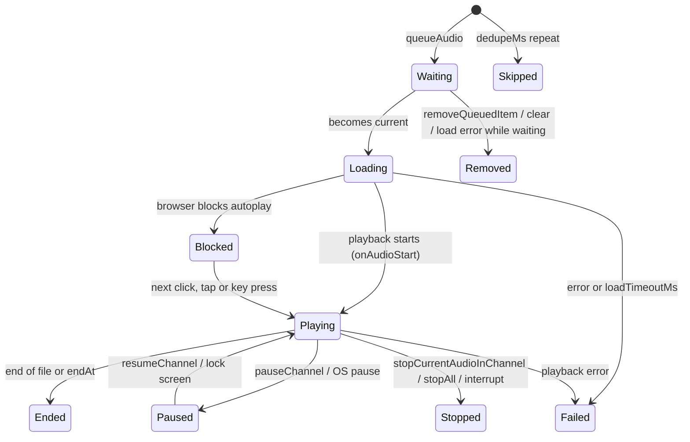

# Item Lifecycle



## States and outcomes

| State   | What it means                                                              |
| ------- | -------------------------------------------------------------------------- |
| Waiting | Queued behind the current item; preloaded if within `prefetchCount`.      |
| Loading | Current item; `play()` requested; `isLoading` is true until data arrives. |
| Blocked | The browser needs a user gesture; the item keeps its place.               |
| Playing | Audio is playing; progress and cue events fire.                           |
| Paused  | Paused by you, a fade, the page being hidden (`pauseWhenHidden`) or the OS. |

The item's `finished` promise settles with how it left:

| Outcome     | When                                                         |
| ----------- | ------------------------------------------------------------ |
| `'ended'`   | It played to the end (or to `endAt`).                        |
| `'stopped'` | It was skipped, stopped, or cleared by `interrupt`.          |
| `'error'`   | It failed to load or play, or did not start in time.        |
| `'removed'` | It was removed while waiting.                                |
| `'skipped'` | It was never queued (a `dedupeMs` repeat).                   |

`started` resolves `true` when playback first starts, or `false` if the item leaves first.

## Timeouts

An item that has not started `loadTimeoutMs` after it was asked to play (15 seconds by default)
fails with a `Timeout` error and the next item plays. The timer pauses while the channel is
paused and does not run while autoplay is blocked. Set `loadTimeoutMs: 0` to wait forever.

## Errors

Errors are reported once through `onAudioError`. A failing current item is skipped; a waiting item
that fails while preloading is removed without disturbing the current one. There are no automatic
retries; re-queue from the error listener if you want them:

```ts
onAudioError(0, (error) => {
  if (error.errorType === AudioErrorType.Network) void queueAudio(error.src, error.channelNumber);
});
```

## Release

When an item finishes in any way, AudioQ pauses its element, aborts its download, disconnects its
Web Audio nodes, removes its listeners and timers, and revokes its `Blob` URL. Finished items are
recorded in the channel's [history](../api-reference/playback-controls#history).
